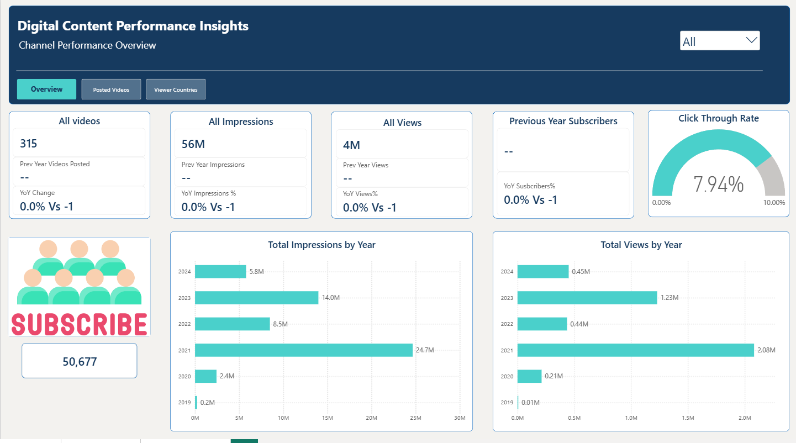
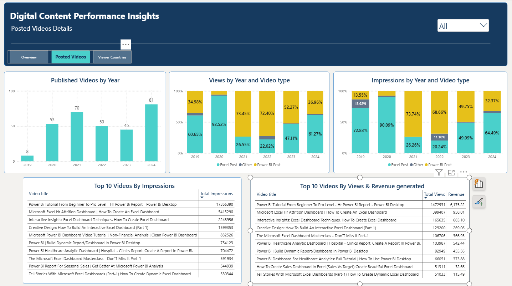
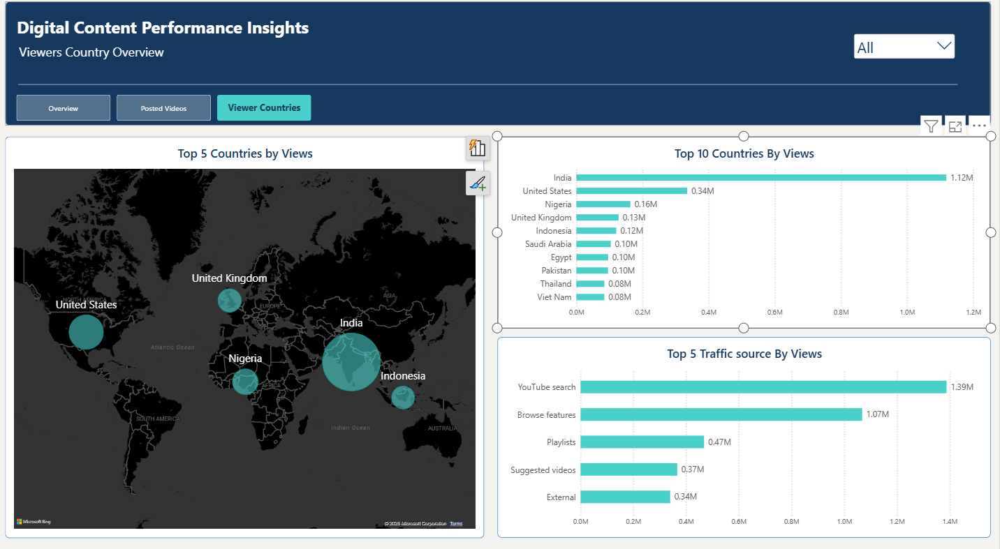

# Digital Content Performance Insights
### YouTube Content Performance, Audience Insights & Growth Trends

## Overview
Digital Content Performance Insights is a Power BI dashboard built to explore YouTube channel performance, publishing activity, and audience geography. It brings key content and audience metrics into an interactive report so the creators can review trends, compare performance across time periods, and explore where viewers are located.

This project demonstrates how Power BI can turn content-level data into a clear, navigable report for performance monitoring and exploratory analysis.

## Business Questions
The report is designed to help explore questions such as:
- How does channel performance change over time?
- How many videos were published during a selected period?
- How do content and publishing trends vary by year or video selection?
- Which countries account for the audience represented in the dataset?
- What patterns are worth investigating further when comparing content performance and audience geography?

## Dashboard Pages

### 1. Channel Performance Overview
Provides a high-level view of channel performance through summary metrics and trend visuals. It is intended to help users review overall performance and compare results across the available time periods.

### 2. Posted Videos
Focuses on video publishing activity. The page helps users explore how publishing volume changes over time and compare activity using the available year and video filters.

### 3. Viewers Countries
Explores the geographic distribution of viewers represented in the dataset. It helps identify countries contributing to the audience and supports further investigation of geographic patterns.

## Tools & Skills
- **Power BI Desktop** — report development and interactive visualisation
- **DAX** — measures and calculations used in the report
- **Data modelling** — organising data for analysis
- **Report design** — KPI presentation, page navigation, filters, and visual hierarchy
- **Exploratory analysis** — reviewing performance, publishing, and geographic patterns

## Interactivity
The report includes navigation between dashboard pages and filters that let users explore the available data by year and video. These controls support focused comparisons without requiring separate static reports.

## Repository Contents
```text
youtube-content-insights-powerbi/
├── README.md
├── Digital Content Performance Insights.pbix
└── screenshots/
    ├── overview.png
    ├── posted-videos.png
    └── viewer-countries.png
```

## How to View the Project
1. Download the `.pbix` file from this repository.
2. Open it in Microsoft Power BI Desktop.
3. Use the page navigation and report filters to explore the dashboard.

## Dashboard Preview

### 1. Channel Performance Overview



### 2. Videos Posted Analysis



### 3. Viewer Countries Analysis



## Key Findings

- **Publishing Trends:** Video publishing peaked in 2024, with 81 videos, compared with 45 in 2023. This represents an increase of 80% in the number of videos published year over year.

- **Content-Type Performance:** Power BI posts accounted for 73.74% of impressions and 73.45% of views in 2021. In 2022, they contributed 68.66% of impressions and 72.40% of views, indicating a strong share of performance in those years.

- **Top Video Performance:** The Power BI tutorial *“Power BI Tutorial From Beginner To Pro Level - Hr Power Bi Report - Power Bi Desktop”* recorded 1,472,931 views and 6,175.22 in reported revenue in the displayed table, making it a notable performer among the listed videos.

## About
**Author:** Aradhana Srivastava
**GitHub:** https://github.com/daradhana 
**LinkedIn:** https://www.linkedin.com/in/daradhanasri25/
---

